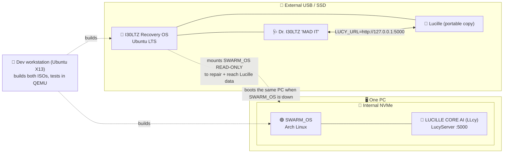

# SWARM_OS Suite: architecture

**v1.0.0 · 2026-09-30** · the source of truth for which OS is which.
If another file disagrees with this one, this one wins. Fix the other file.

## Two operating systems, one PC

| | 🟣 **SWARM_OS** | 🔴 **I30LTZ Recovery OS** |
|---|---|---|
| **Base** | **Arch Linux** (built with archiso) | **Ubuntu LTS** |
| **Lives on** | **Internal** drive (NVMe, installed) | **External** drive (USB / portable SSD, boots from outside) |
| **AI assistant** | **LUCILLE CORE AI "LLcy"** | **Dr. I30LTZ "MAD IT"**, plus access to **Lucille** |
| **Job** | Daily life, gaming, coding | PC repair, data recovery, rescuing SWARM_OS |
| **Repo** | SWARM_OS / Lucille repo | **this repo** (`i30ltz-recovery`) |
| **Setup kit** | lives in the SWARM_OS repo | [`system/i30ltz-recovery-first-boot/`](../system/i30ltz-recovery-first-boot/README.md) |

Rules:
1. **Never mix them.** SWARM_OS never gets Recovery OS packages or identity,
   and Recovery OS never gets SWARM_OS identity.
2. **Recovery OS stays external.** Keep it off the internal drive, so it still
   works when SWARM_OS, the internal drive, or the bootloader is broken.
3. **Only one OS runs at a time.** You pick one at boot: internal means
   SWARM_OS, and the external drive means Recovery OS.

The **dev workstation** (the Ubuntu ThinkPad X13) is a third machine. It
builds and tests both OSes but *is* neither. Its kit is
[`system/dev-workstation-first-boot/`](../system/dev-workstation-first-boot/README.md).

## Lucille has to work from Recovery OS

Lucille is SWARM_OS's assistant, but you also need it when SWARM_OS won't boot.
That's usually exactly when you need help most. Recovery OS provides it in two
ways, used in this order:

### A. Portable Lucille on the external drive (default)
- A copy of the Lucille runtime (the `lucy-server` binary, config and models)
  lives **on the Recovery OS drive** at `/opt/lucille-portable/`.
- On Recovery OS it listens on **`127.0.0.1:5000` only**, the same port and
  API as on SWARM_OS, so Dr. I30LTZ can reach it with
  `LUCY_URL=http://127.0.0.1:5000`.
- **Why this is the default:** it works even when the internal drive is dead
  or encrypted and locked, and it never writes to the drive being repaired.
- It gets refreshed from SWARM_OS on purpose (a sync step with checksums),
  never automatically while repairing.

### B. Your real Lucille data from the internal drive (read-only)
- Recovery OS can unlock (LUKS) and mount the SWARM_OS partition
  **read-only**, then point portable Lucille at your real memory and notes
  there. Lucille then knows your context, not just the snapshot.
- Anything Lucille writes during a recovery session goes to the
  **external drive** (`/var/lib/lucille-portable/`), never the internal one.
- Skip this if the internal drive is failing. Image it first with
  `i30ltz-writeblock on` + `ddrescue`, then use the image instead.

### Safety rules for Lucille on Recovery OS
- Loopback only. The Recovery OS firewall blocks all incoming traffic, and
  Lucille never listens on the network.
- The internal drive is read-only by default. Writing to SWARM_OS (a repair)
  is always a deliberate, separate MAD IT action and never a side effect of
  talking to Lucille.
- No secrets in this repo. Auth tokens are generated per machine at first
  boot and never committed.

## Status (2026-09-30)

| Item | State |
|---|---|
| Recovery OS first-boot kit (Ubuntu) | ✅ built · `system/i30ltz-recovery-first-boot/` v2.0.0 |
| Dev workstation kit | ✅ built · `system/dev-workstation-first-boot/` v2.0.0 |
| Recovery OS installed to an **external** drive | ⏳ planned |
| Portable Lucille on Recovery OS (A) | ⏳ planned: needs a `lucille-portable` module + sync script |
| Read-only SWARM_OS mount for Lucille data (B) | ⏳ planned |
| `native/` Rust scaffold retargeted from Debian 12 → Ubuntu LTS | ⚠️ to do: `native/` still says Debian 12 |
| SWARM_OS setup kit | lives in the SWARM_OS repo, not here |
