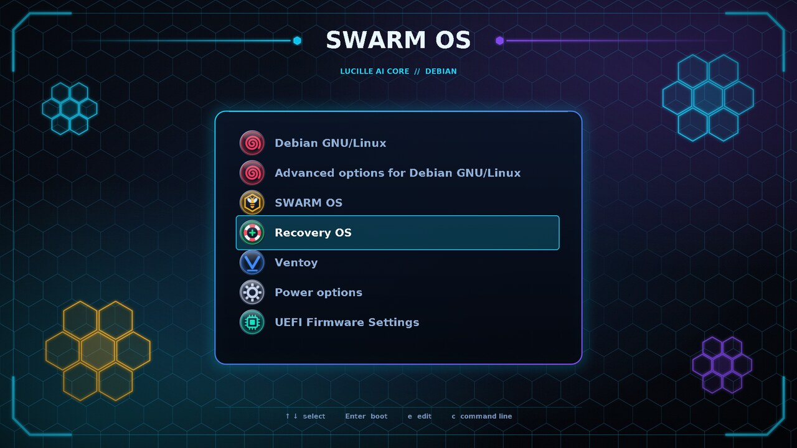

# swarm-grub

Obsidian-and-electric GRUB theme for **Debian's** boot menu: neon medallion icons, hex "wasp nest"
artwork, a glass menu panel, a live countdown. Optionally (`--with-entries`) it also adds the SWARM OS,
Recovery OS, Ventoy and Power entries. It never runs `grub-install` and never touches the EFI partition or any disk.



## Install

```
# optional: Orbitron for the intended look, see fonts/README.md  ->  swarm-grub/fonts/Orbitron-Bold.ttf
# optional: sudo apt install librsvg2-bin      (without it the build uses the librsvg library via Python)
sudo bash swarm-grub/install.sh --with-entries      # theme + SWARM OS / Recovery OS / Ventoy / Power entries
sudo reboot
```

Theme alone (Debian's menu rows stay exactly as they are): `sudo bash swarm-grub/install.sh`.

`install.sh` builds the theme, copies it to `/boot/grub/themes/swarm-grub`, adds one clearly marked block
(`GRUB_THEME`, `GRUB_TERMINAL_OUTPUT=gfxterm`, `GRUB_GFXMODE`, `GRUB_BACKGROUND`) to `/etc/default/grub`, then generates the new
`grub.cfg` **aside**, runs `grub-script-check`, confirms it really uses the theme and loads every font, and
only then swaps it in. Anything failing restores `/etc/default/grub` and the old theme. Backups go to
`/var/backups/swarm-grub/<timestamp>/`.

| Want to... | Run |
|---|---|
| See exactly what it would change, touching nothing | `bash swarm-grub/install.sh --dry-run` |
| See the theme in a real GRUB first (QEMU, no changes) | `swarm-grub/preview.sh` (`-e 9` for a long menu) |
| Undo it (theme, entries and settings) | `sudo bash swarm-grub/install.sh --uninstall` |
| Drop only the entries, keep the theme | `sudo bash swarm-grub/install.sh --without-entries` |
| Run the tests | `cd swarm-grub/tests && python3 -m unittest -v test_swarm_grub` |
| Test the entries in a real GRUB (QEMU, ~15 s) | `swarm-grub/tests/qemu_entries.sh` |

Debian only (it checks `/etc/os-release`): SWARM OS and Recovery OS have their own GRUBs and themes.

## The menu entries (`--with-entries`)

`entries/20_swarm_entries` becomes `/etc/grub.d/20_swarm_entries`, so the menu reads: Debian, Advanced options,
**SWARM OS, Recovery OS, Ventoy, Power options**, UEFI Firmware Settings. It replaces the stale
`grub_themes/09_swarm_debian`. Each OS is started by **chainloading its own EFI bootloader** (it keeps its own menu,
kernel options and Secure Boot chain), found by the filesystem UUID of its EFI partition because drive letters swap:

| Entry | Finds | Loads (first that exists) |
|---|---|---|
| SWARM OS | ESP `FE19-A70F` (internal NVMe) | `\EFI\SWARM_OS\grubx64.efi`, `\EFI\BOOT\BOOTX64.EFI` |
| Recovery OS | ESP `A367-87E3` (Samsung T7) | `\EFI\i30ltz\shimx64.efi`, `grubx64.efi`, `\EFI\BOOT\BOOTX64.EFI` |
| Ventoy | `626B-4255`, or label `VTOYEFI` | `\EFI\BOOT\BOOTX64.EFI`, `grubx64.efi`, `\EFI\ventoy\grubx64.efi` |

A disk that is not plugged in, or an ESP without the expected file, shows what was looked for and returns to the
menu. Because the entries replace os-prober's rows, the installer sets `GRUB_DISABLE_OS_PROBER=true` in its block
(otherwise SWARM OS would be listed twice). Update the UUIDs in the script's header and body if a disk is reinstalled
(`lsblk -o NAME,LABEL,UUID`; firmware paths: `efibootmgr -v`).

**Tested:** the script passes GRUB's own `grub-script-check`, and `tests/qemu_entries.sh` runs it in a real UEFI GRUB with
stand-in bootloaders: it finds the partition, prefers the right file, falls back through the list, finds Ventoy by label,
and fails politely with the disk missing or the file missing. **Not tested:** booting the real SWARM OS / Recovery OS /
Ventoy from this menu. Try each entry once after installing; the firmware boot menu (F12) is always the way back.

## Icons

GRUB picks an icon from a menu entry's `--class` names, first match wins. The theme ships these
(`icons/*.svg` are the sources, rendered to 64 px PNGs at build time):

| Class(es) | Icon | Used by |
|---|---|---|
| `debian` | red swirl | Debian's entries |
| `swarm_os` (`swarm-os`, `swarm`) | amber wasp in a hex cell | SWARM OS |
| `recovery_os` (`recovery-os`, `recovery`) | lifebuoy with a plus | Recovery OS |
| `ventoy` | blue **V** on a base line | Ventoy (add the entry later: the icon is ready) |
| `tools` | gear | the "Power & firmware" submenu |
| `restart` (`reboot`), `shutdown` (`poweroff`, `halt`) | circular arrow, power symbol | its items |
| `efi` | chip | "UEFI Firmware Settings" |
| `linux` (`gnu-linux`, `gnu`), `arch` (`archlinux`) | shell prompt, Arch "A" | generic Linux, os-prober's Arch entries |
| `unknown` | question mark | anything else |

Adding one: drop `icons/<class>.svg` (128x128 art; copy an existing file for the medallion), add any alias
names to `ALIASES` in `build.sh`, and add the class to `REQUIRED_CLASSES` in the test if the menu needs it.
The entries script uses exactly these class names, and a test keeps it that way.

## How it fits together

- `theme.txt.in` is the layout template; `build.sh` fills in the real font names read back from the `.pf2` files.
- `background.svg` is 1920x1080 and has the glass panel painted in; `theme.txt.in` positions the menu with
  percentages so they line up at any 16:9 mode. A test checks that the menu sits inside the panel.
- `selection.svg`, `item.svg`, `terminal_box.svg` are tiny 9-slice masters cut into GRUB pixmaps by viewBox.
  `item.svg` is transparent on purpose: GRUB insets a row by its pixmap's padding, so without it the highlighted
  row would jump down 8 px.
- `preview.sh` boots a standalone GRUB under QEMU/OVMF with the same startup sequence `grub-mkconfig` emits
  for a theme (using the real `entries/20_swarm_entries`) and takes screenshots.
- `GRUB_BACKGROUND` points at `terminal_bg.svg`'s dark backdrop: Debian's `05_debian_theme` paints a background behind
  the `c` console / `e` editor, which would otherwise be desktop-base's blue wallpaper.
- `tools/svg2png.py` is the fallback renderer; `tools/pf2name.py` reads a font's real name.

## Known limits

- Orbitron could not be tested here (the font is not on this machine); the preview uses the DejaVu fallback.
  Orbitron is wider, so very long entry titles clip a little earlier.
- Real-hardware boot is the final proof; QEMU shows the same GRUB, not your firmware's graphics mode.
- Without `--with-entries` the menu rows are Debian's own (plus whatever os-prober finds).
- Secure Boot is off today. When it is on, the SWARM entry must point at the signed loader
  (`\EFI\SWARM_OS_SB`, see `70-scripts/make_swarm_secureboot.sh`); edit the path list in the script then.
